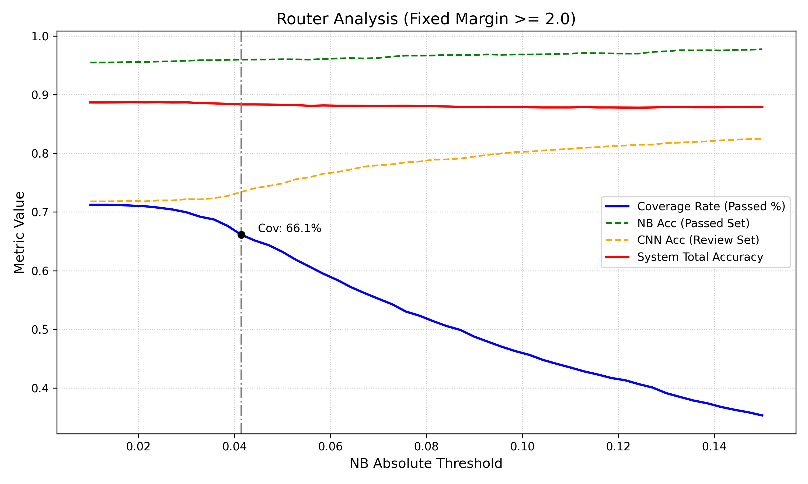

# 🤖 Agent 智能意图识别与级联路由系统 (Agent Intent Routing System)


## 📖 项目简介
本项目实现了一个用于大语言模型 Agent 系统的**智能意图识别与路由分发中枢**。针对真实业务场景中单一模型（如纯大模型或纯小模型）存在的“延迟-准确率”难以权衡的问题，系统采用**级联路由（Cascade Routing）**架构，结合传统机器学习（NB）与深度学习（TextCNN）的优势，并接入大模型（GLM-4-Flash）完成具体工具执行，实现了从“用户输入 ➡️ 意图识别 ➡️ 置信度路由 ➡️ 工具调度/LLM执行 ➡️ 兜底反馈”的全链路闭环。

## 🏗️ 系统架构与核心机制

系统核心分流逻辑分为三级：

1. **第一级（极速粗筛）**：朴素贝叶斯（NB）分类器计算置信度。若绝对概率高于阈值，且 Top-1 与 Top-2 概率的 **Margin（相对边际）** 达标，则直接触发对应工具（毫秒级响应）。
2. **第二级（深度复核）**：若 NB 拿不准，请求转入 TextCNN 模型。TextCNN 基于多尺度卷积核捕捉局部语义特征，若置信度达标，则执行路由。
3. **第三级（LLM兜底）**：若双模型均无法给出高置信度预测（如乱码、闲聊、情感倾诉），系统拦截指令，转入基于 GLM-4-Flash 的通用闲聊/安全兜底模块，防止 Agent 误触发危险操作。

## ✨ 核心创新点 (Highlights)

* **引入 Margin (相对置信度) 过滤机制**：在 150 类长尾多分类场景下，解决了 Softmax 概率稀释导致的绝对阈值失效问题。通过计算 `Top-1 / Top-2` 的倍数差，有效缓解了朴素贝叶斯的“过度自信”误判。
* **大小模型协同的级联架构**：将轻量级 ML 模型、小型 DL 模型与大语言模型串联。用 1% 的算力解决 80% 的简单高频指令，用大模型处理 20% 的复杂边界情况，极大降低了系统的平均延迟与 API 成本。
* **严格的防数据泄漏流水线**：在特征工程阶段，严格将词表构建（Vocab）与 TF-IDF 拟合限制在训练集内，确保模型在 CLINC150 真实数据集上的评估结果（NB: 81.6%, TextCNN: 87.9%）客观有效。
* **端到端可视化交互**：基于 Gradio 搭建 Web 演示，将底层黑盒的“意图分类、置信度、路由决策依据”完全白盒化展示。

---

## 🛠️ 快速开始 (Quick Start)

### 步骤 1：环境准备
推荐使用 Conda 创建隔离环境，并安装项目所需依赖：
```bash
conda create -n intent_agent python=3.10 -y
conda activate intent_agent
pip install pandas scikit-learn torch gradio joblib python-dotenv openai datasets
```

### 步骤 2：配置大模型 API Key
在项目根目录新建 `.env` 文件，填入智谱清言（GLM）的 API Key（用于执行工具与最终兜底）：
```env
API_KEY=your_api_key_here
```

### 步骤 3：数据处理与模型训练（全流程）
依次运行以下脚本，完成从真实数据拉取到模型权重的生成：

```bash
# 1. 探索性数据分析（可选，查看数据分布与长度统计）
python EDA.py

# 2. 下载 CLINC150 真实数据集，过滤目标类别，生成 real_train.csv 和 real_test.csv
python download_data.py

# 3. 训练传统机器学习基线（朴素贝叶斯、KNN），并将模型保存至 checkpoints/
python baseline_ml.py

# 4. 训练 PyTorch TextCNN 模型（生成权重 .pth 及 vocab/config 字典，保存至 checkpoints/）
python dl_model.py
```

*(注：根目录下的 `data_generator.py` 是用于早期流程验证的合成数据生成脚本，已经废弃但保留作为项目演进的开发记录。)*

### 步骤 4：启动 Web 演示系统
在终端运行启动脚本：
```bash
python app.py
```
运行成功后，在浏览器打开 `http://127.0.0.1:7860` 即可体验完整的意图识别、级联路由与 LLM 执行闭环。

---

## 📊 实验结果 (CLINC150 数据集)

| 模型架构 | 准确率 (Accuracy) | Macro-F1 | 特点 |
| :--- | :--- | :--- | :--- |
| KNN (k=5) | 72.1% | 0.72 | 高维稀疏空间距离度量失效 |
| 朴素贝叶斯 (NB) | 81.6% | 0.81 | 速度极快，但存在过度自信问题 |
| **TextCNN** | **87.9%** | - | 捕捉局部语义组合，作为第二级复核器 |

### 路由系统性能分析曲线


## 🔮 未来展望 (Future Work)
* 引入 LLM 作为 OOD (域外) 常识拦截器，进一步处理情感倾诉与指令混合的复杂场景。
* 探索基于句向量的语义相似度路由，实现冷启动阶段的意图快速扩展。

---
*本项目为人工智能专业课程大作业实战成果，完整覆盖了数据清洗、模型训练、系统架构设计及 API 集成全流程。*